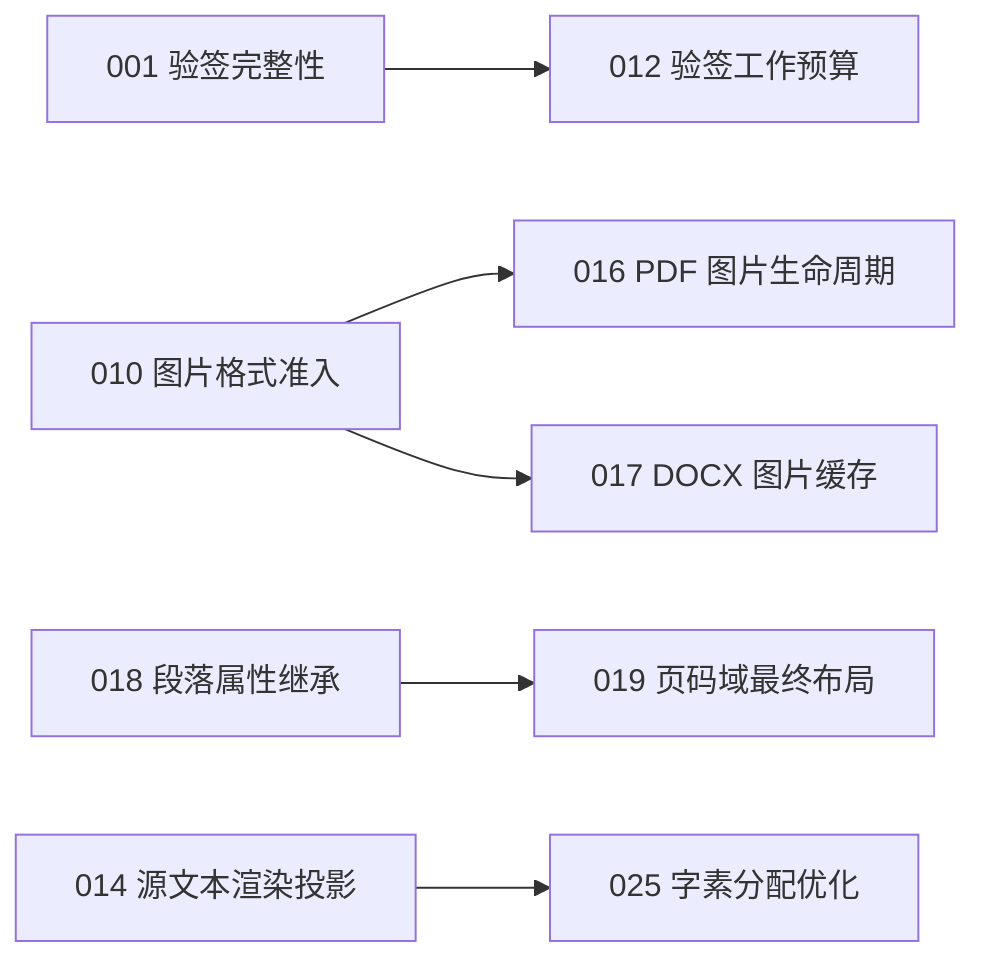

# 实施计划索引

基于 [2026-10-15 深入审查](audit-2026-10-15.md)，源码基线 `d0f88c7321a57443a4cb0ec92631664f66ed8cc0`。用户已要求拆解完整报告；本目录现有 **26 份修复计划、1 份调查计划、3 份可选方向设计计划**，覆盖 F01–F28、I01、D01–D03，已按用户授权启动隔离执行，实际进度见 [执行调度记录](execution-status.md)。

每份计划独立包含代码摘录、修改范围、回归场景、命令/预期、停止条件和验收要求。S=数小时、M=约一天、L=多日，均为实施粗估，复杂跨平台/分页任务按 L；风险指改动引入回归的风险。编号是建议执行顺序，不是必须把前面全部完成才能启动后面。

## 后续实施

除004外的五项保留边界现已分别启动独立新会话实施；全部完成后统一集成，见[后续调度记录](followup-2026-10-16.md)。下列验收统计属于上一轮冻结交付。

## 当前执行候选

本地综合候选：`codex/audit-integration`，源码 `b40e9c1dc5011ab08979e10e2bbbc9766b855770`，位于 `/Users/wanghongyi/.codex/worktrees/audit-integration/ofdrw.net`。[集成验收记录](/Users/wanghongyi/.codex/worktrees/audit-integration/ofdrw.net/artifacts/integration/final/acceptance.md) 与 [38项原提交映射](/Users/wanghongyi/.codex/worktrees/audit-integration/ofdrw.net/artifacts/integration/mapping.json) 可逐项复查。

当前已完成最终全套2812/2812零跳过、可信字体65、Python20、API文档、11包消费与独立六项目516/516。最终20页PNG、2份SVG及13份PDF共20页macOS Preview均已实际检查通过；协调者核验全部20条URL/页码AX、原始JPEG与PDF哈希并抽查截图。30份计划均已分别执行，其中29项完成各自范围验收，003为IMPLEMENTED/PARTIAL。003直接BuiltIn副标题斜体是基线已存在的视觉失败，未冒充全部视觉通过；027只调查确认，028–030只设计。主checkout生产源码未改，未推送、创建PR、合并或发布。

## 粒度与合并依据

- **003 = F03 + F17**：同属 DOCX→PDF 候选校验与最终提交边界，可共用假渲染器和异常流；保留“错误候选可回退”和“输出提交失败不可回退”两个独立断言。
- **004 = F04 + F26**：路径别名保护必须在真实 Windows/macOS 分支验证，修复与已有测试矩阵一起交付。
- **007** 包含根目录 Writer 与 Signing 两处同类路径问题，可分两个提交，统一以公开 loader 回读验收。
- 其余发现按独立根因/所有权/验收保留独立计划。**013** 只加强验证，不能顺手修改产品；**024** 先设计进程所有权再实现，不压成小修；**027** 只调查，不把未知问题当确定缺陷。
- **028–030** 是可选产品方向的设计/spike，不与缺陷优先级混排，也不自动启动新功能实现。

## 修复计划

| 计划 | 对应发现 | 优先级 | 工作量 | 风险 | 硬前置 | 状态 |
|---|---|---|---|---|---|---|
| [001 让验签总结果覆盖每个声明列表](001-signature-completeness.md) | F01 | P1 | S | LOW | — | DONE（独立复核通过） |
| [002 保留根目录图片的真实载荷](002-root-image-roundtrip.md) | F02 | P1 | S | LOW | — | DONE（独立复核及12页Preview） |
| [003 在有效 PDF 候选与最终输出提交之间建立明确边界](003-docx-pdf-output-transaction.md) | F03 + F17 | P1 | M | MED | — | 已实现；既有斜体缺陷导致视觉部分失败 |
| [004 阻止转换路径别名覆盖输入并覆盖真实平台分支](004-cli-path-identity-native-gates.md) | F04 + F26 | P1 | M | MED | — | DONE（Preview通过；Windows链接7项跳过） |
| [005 在展开 DOCX 表格网格前限制派生列数](005-docx-table-grid-budget.md) | F05 | P1 | S | LOW | — | DONE（独立18项及12页Preview） |
| [006 在 CLI 展开页范围前校验容量](006-cli-page-selection-budget.md) | F06 | P1 | S | LOW | — | DONE（独立复核通过） |
| [007 让根目录文档与签名列表生成合法 ZIP 路径](007-root-package-entry-paths.md) | F07 | P1 | M | LOW | — | DONE（独立复核通过） |
| [008 普通保存时保留未建模的 CustomTags 内容](008-custom-tags-preservation.md) | F08 | P1 | M | MED | — | DONE（独立17项回归通过） |
| [009 对页眉页脚遗漏内容给出真实保留状态](009-docx-decoration-loss-diagnostics.md) | F09 | P1 | M | MED | — | DONE（独立30项、Preview28页） |
| [010 在通用图片识别前拒绝不安全或不支持格式](010-image-decoder-admission.md) | F10 | P1 | M | MED | — | DONE（图片准入；独立28项及12页Preview） |
| [011 对 cmap 解析去重并在解析前计费](011-cmap-parse-work-budget.md) | F13 | P1 | M | MED | — | DONE（独立40项、Preview14页、SVG9图） |
| [012 限制验签累计工作并复用摘要](012-signature-verification-work-budget.md) | F14 | P1 | M | MED | 001 | DONE（独立验签40项、CLI78项） |
| [013 让包消费栅格往返验证逐页内容](013-package-raster-all-pages.md) | F27 | P2 | M | LOW | — | DONE（独立包E2E、Preview11页） |
| [014 按源 TextCode 语义生成渲染游程](014-source-text-render-projection.md) | F11 | P1 | M | MED | — | DONE（独立97项、Preview9页、SVG2图） |
| [015 在 PDF/SVG 中应用有效路径样式](015-path-effective-style.md) | F12 | P1 | M | MED | — | DONE（独立37项、Preview15页、SVG9图） |
| [016 释放 PDF 普通图片解码缓冲并复用资源](016-pdf-image-buffer-lifetime.md) | F15 | P1 | M | MED | 010 | DONE（独立15项、Preview11页） |
| [017 在一次 DOCX 转换内共享图片部件载荷](017-docx-image-part-cache.md) | F16 | P2 | S–M | LOW | 010 | DONE（独立21项、Preview12页） |
| [018 按属性存在性合并段落格式](018-docx-paragraph-property-inheritance.md) | F18 | P2 | M | MED | — | DONE（独立15项及9页Preview） |
| [019 在最终分页上下文中解析正文和表格页码域](019-native-page-field-finalization.md) | F19 | P2 | L | MED | 018 | DONE（独立10项、Preview11页） |
| [020 提交完成后不因成功通知异常返回失败](020-cli-post-commit-notification.md) | F20 | P2 | S | LOW | — | DONE（独立CLI128、Preview5页、SVG） |
| [021 只把选项位置的 help 识别为帮助](021-cli-help-token-parsing.md) | F21 | P2 | S | LOW | — | DONE（独立CLI169、Preview4页） |
| [022 让带诊断的合并入口传播取消](022-merge-cancellation-token.md) | F22 | P2 | S | LOW | — | DONE（独立库4项、CLI2项） |
| [023 让字体目录枚举及时取消并限制链接遍历](023-font-discovery-cancellation.md) | F23 | P2 | S–M | MED | — | DONE（独立9项、Preview7页） |
| [024 在包装进程退出后仍清理其子进程](024-external-process-ownership.md) | F24 | P2 | L | MED | — | DONE（独立15项；三平台实测） |
| [025 避免无定位文字的完整字素物化](025-text-coverage-allocation.md) | F25 | P2 | M | MED | 014 | DONE（独立23项、Preview7页、SVG） |
| [026 同步当前路线图与已有实现状态](026-roadmap-state-reconciliation.md) | F28 | P2 | S | LOW | — | DONE（独立链接检查151项） |

## 调查计划

| 计划 | 对应发现 | 优先级 | 工作量 | 风险 | 硬前置 | 状态 |
|---|---|---|---|---|---|---|
| [027 先验证附件描述符的无操作往返边界](027-attachment-preservation-investigation.md) | I01 | P2 | S | LOW | — | DONE（调查CONFIRMED；修复未实施） |

027 的结果可为 CONFIRMED / REJECTED / INCONCLUSIVE。调查交付 DONE 不意味着附件问题已修复；若确认需修复，在结果中形成最小实施范围再安排执行。

## 可选方向设计

| 计划 | 对应发现 | 优先级 | 工作量 | 风险 | 硬前置 | 状态 |
|---|---|---|---|---|---|---|
| [028 设计复用 FlowDocument 的纯文本入口](028-plain-text-ofd-design.md) | D01 | P3 | M | LOW–MED | — | DONE（仅设计；独立26链接检查） |
| [029 设计有界多页 SVG HTML 预览](029-multipage-html-design.md) | D02 | P3 | M | MED | — | DONE（仅设计；11链接复核） |
| [030 界定可解释的只读归档预检](030-archival-preflight-spike.md) | D03 | P3 | L | MED | — | DONE（仅设计；19链接复核） |

这些计划的 DONE 只表示设计交付完成。028 复用 FlowDocument 的文本入口；029 设计一次读包的多页 SVG/HTML，明确转义、ID 隔离与预算；030 设计只读归档预检，不承诺标准认证。三者均不修改生产实现。

## 推荐执行批次

1. **第一批 001–006**：错误验签成功、图片数据丢失、输出提交边界、路径身份和展开前限额。涉及同一 CLI Program.cs 的 004/006 应串行整合。
2. **第二批 007–012**：根目录条目、CustomTags 保留、页眉页脚损失诊断、图片格式准入、字体解析预算、验签工作预算。012 在 001 后整合，避免保留错误的成功聚合；010 的代码与图像缓存计划先后衔接。
3. **第三批 013–019**：先增强包消费逐页比较，再按明确样例处理文字/路径/图片渲染与 DOCX 样式/字段。013 不替代各修复的缺陷专用断言；现有产物若暴露失败，不降低阈值放行。
4. **第四批 020–025**：CLI 通知/参数/取消、字体发现、进程所有权与字素分配。024 工作量较大，可在不冲突的隔离 checkout 提前设计；不能简单移除 HasExited 分支。
5. **026 / 027** 可独立开展。026 更新当前索引而保留历史证据；027 调查结果不阻塞已确认缺陷。028–030 按产品优先级单独选择执行。

## 硬依赖与集成顺序

- 012 必须沿用 001 的不完整报告语义；预算失败不能通过聚合。
- 016/017 接入图片复用前先保留 010 的格式准入，不能缓存未经验证的载荷。
- 019 的布局重算以 018 的属性继承稳定结果为基础，避免测试基线相互改变。
- 025 优化 014 已选定的渲染游程，不回到错误 raw projection。
- 013 建议在 014–019 的视觉修复集成前完成，但它不是源码硬依赖，也不能代替各计划的 PDF/SVG/Native 专用视觉验收。
- 028 的未来实施应先同步 026 的路线图；029 的未来实施须完成 014/015 或明确缩小保真承诺。这些不阻止先做设计。

## 文件协作边界

“无硬前置”不表示适合在同一 checkout 同时编辑。按下表协调，独立 checkout 仍需逐个集成并重跑受影响门：

| 共享文件/区域 | 计划 | 建议 |
|---|---|---|
| Cli/Program.cs、DocumentTools、Images | 001 的CLI测试、004、006、020、021、022 | 004→006→020→021→022 串行整合；001通常仅结果模型变化 |
| DocxModelReader.cs | 005、009、010、017、018 | 005/009可独立设计，010→017；合并时重跑完整 Docx 项目 |
| OfdReader / PackageWriter / envelope | 002、007、008；027只读调查 | 002→007→008，先锁普通往返与来源保留契约 |
| OfdToPdfConverter / SvgConverter / DocumentFontContext | 010、011、014、015、016、025 | 先010/011，再014/015/016按函数范围整合，025最后 |
| 字体解析与覆盖 | 011、025 | 可先独立实现；集成时确认预算/取消/字素语义均保留 |
| Signatures verifier | 001、012 | 001→012 |
| .github/workflows/ci.yml | 004、024 | 只合并所需原生子集，避免恢复旧过滤器 |

## 执行与完成状态

状态使用 `TODO` → `IN PROGRESS` → `DONE`；无法继续写 `BLOCKED（具体原因）`；已被独立修复或证据推翻写 `REJECTED（依据）`。涉及视觉的任务，Preview 未完成时不能写整体 DONE；可以在状态备注写功能已通过/待桌面验收。

- 实施前对照计划基线与未提交改动做漂移检查；前置计划带来的改动也要重读，不能机械替换过时片段。
- 每份计划内已有完整 .NET 环境、单节点命令和测试矩阵；不能把过滤器零命中、未还原依赖、旧 DLL 或旧产物算通过。
- 共享布局/字体/转换链路须全套回归与本次本地包消费 E2E；视觉按 AGENTS.md 分别报告功能、自动 PNG、PNG 目视、Preview。Native 必须检查本次 DOCX→Native OFD→PDF 的页面。
- 计划不授权发布、推送、PR 或合并。修复、测试、视觉、合并、发布是不同状态，不互相替代。

## 本次计划编写验证

本轮只修改 `plans/`，未运行 restore/build/.NET测试/转换/Preview。计划中的命令是给执行者的验收入口，不是本轮已通过的证据。原审查的 Python 20项：15通过、2失败、3报错；后5被缺少 SES project.assets.json 阻塞，CI先restore，未认定为CI回归。

文档交付检查已完成：32 个审查编号分别映射到30份计划，无遗漏/无重复；148个本地链接和94段源码摘录与基线核对；依赖无环；两组独立复核检查了全部30份计划。复核发现的导出字体调用方、跨项目测试范围、单目录惰性枚举、进程fixture/平台筛选及安全基线复现等问题已写回计划。该段为计划交付时的快照；当前实施状态见上表和执行调度记录。

## Considered and rejected

- 不重复实现已存在的 flow/table/image IO、password v2、SES或受限矢量；当前索引陈旧由026处理。
- Native/DualLayer 差异、整行分页、受限图形/字体回退、SES dev/interop 和默认 Unsupported 是既定边界。
- 不盲升 ImageSharp/PdfSharpCore、不因文件大做全库重构、不为了覆盖把完整CI矩阵机械三倍复制。
- 不把历史未合并/未验收快照改写为当前通过，不把只读依赖检查当发布资格。
- 附件未知字段保留仅列027调查；没有借CustomTags证据直接判定。
- 更多被排除项及证据边界见原审查报告，原报告的静态结论不等于已执行运行时复现。
